# Tesla Vehicle Card

A full-screen style control card for **Tesla vehicles** in Home Assistant — single file, zero dependencies, with the car rendered live by Tesla's official configurator. Works with the Model Y (2025+ refresh and 2020–2025), Model 3 (2017–2024), and the refreshed Model S / Model X (2021+). The card element is `custom:tesla-vehicle-card`; the private builds' `custom:model-y-card` remains registered as a legacy alias, so existing dashboards keep working.

中文说明见 [README.zh-CN.md](README.zh-CN.md) ／ 日本語は [README.ja.md](README.ja.md)

[](https://my.home-assistant.io/redirect/hacs_repository/?owner=AidaShika&repository=hass-tesla-vehicle-card&category=plugin)

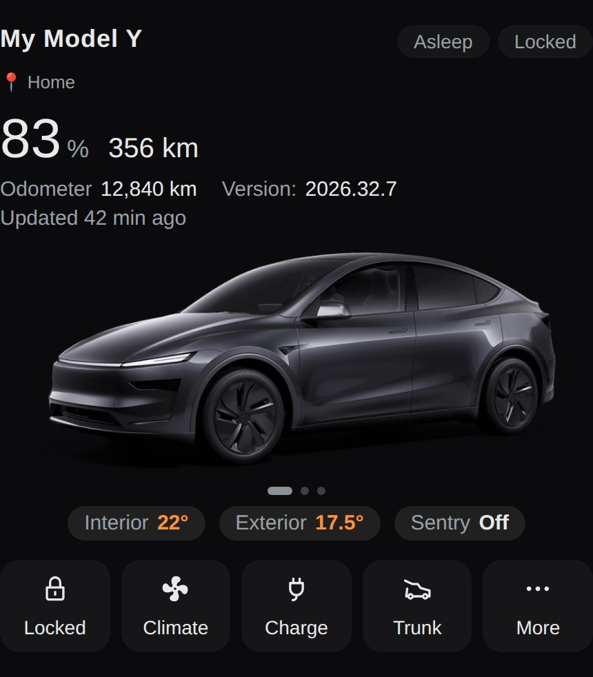

## Features

- **Your exact car** — the vehicle image is Tesla's official configurator render, generated from your model / paint / wheels / interior option codes. No image packs to download, no screenshots to prepare; swipe or tap the car to switch between front 3/4, side and rear 3/4 views.
- **Five models, verified codes** — built-in presets for Model Y refresh ("Juniper"), Model Y 2020–2025, Model 3 2017–2024, Model S 2021+ and Model X 2021+. Every option code in the tables was verified against Tesla's live configurator on 2026-10-24.
- **Escape hatch for everything else** — for models without a preset (Model 3 "Highland", pre-refresh Model S, …), paste the full `image_options` string from your own Tesla account vehicle image URL and the card uses it verbatim.
- **At a glance** — battery level and range (in your entities' units), odometer, software version (with an "update available" badge), online/asleep and lock state, data freshness ("updated 5 min ago"), cabin/exterior temperatures, Sentry state, tyre pressures, and an alert row if a door, window, frunk or trunk is left open.
- **Location & navigation** — while navigating, an info row shows the destination, remaining distance and ETA; otherwise it shows the car's location from its device tracker.
- **Climate panel** — on/off, target temperature, front seat and steering-wheel heaters, defrost, and Keep / Dog / Camp cabin modes, over the official interior render (exterior render on Model S/X, which have no interior view).
- **Charge panel** — charge state, power, rate, energy added, time remaining, charge-limit and charge-current sliders, start/stop charging and charge-port control.
- **Quick actions with honest feedback** — lock/unlock, frunk, trunk, windows vent, Sentry, flash lights and honk. Actions whose entity doesn't exist are hidden instead of failing silently; commands report success only once the service call actually succeeds (failures show the reason); destructive actions use a two-tap confirmation (tap once to arm, again to run) instead of a browser popup. If the car is asleep, commands wake it first and wait until it is online (with one retry if it dozes off mid-command). When a software update is available and the update entity supports it, the version badge installs it with the same two-tap confirmation and shows progress while installing.
- **Visual editor** — configure the card in Home Assistant's GUI editor: pick the model, paint, wheels and interior from dropdowns (options follow the selected model), no YAML required.
- **Three languages** — Chinese, English and Japanese UI (`language` option, or follow Home Assistant's language automatically). Japanese terms follow the official Japanese Tesla app.
- **Zero dependencies** — one plain JavaScript file, no build step, no other cards required.

## Screenshots

All screenshots, including the main image at the top, are rendered by the card itself with demo data.

|  |  |
|---|---|
| 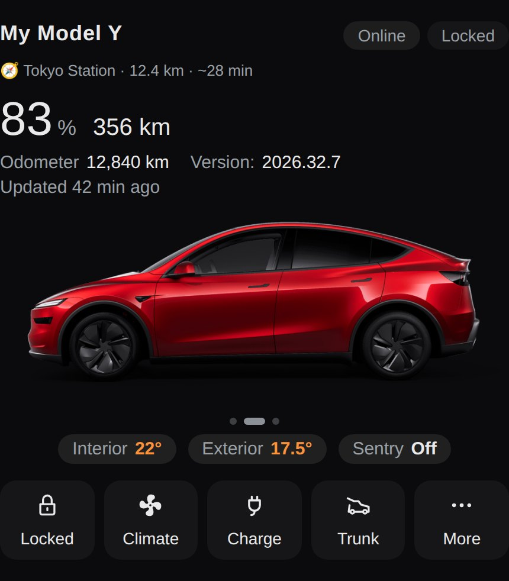 | 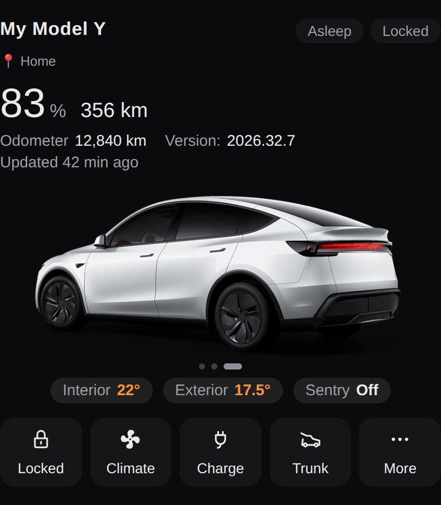 |
| On the road: navigation row with destination, remaining distance and ETA — Model Y refresh, Ultra Red, side view | Rear 3/4 view — Model Y refresh, Pearl White |
| 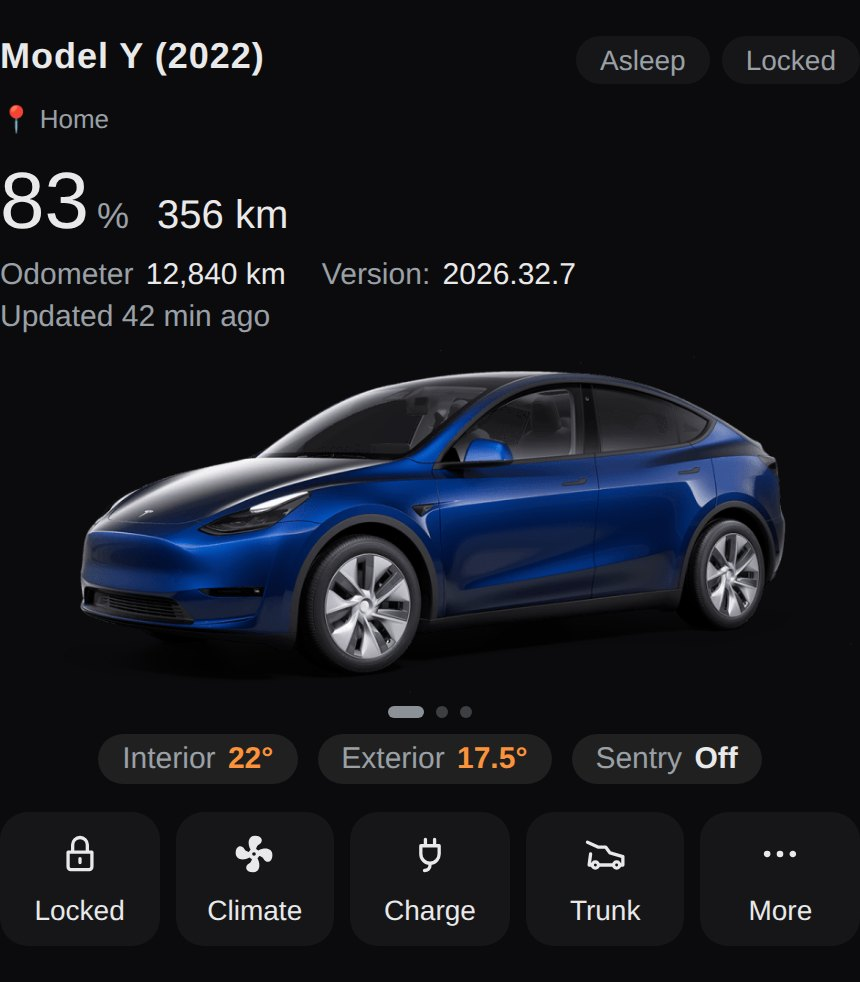 | 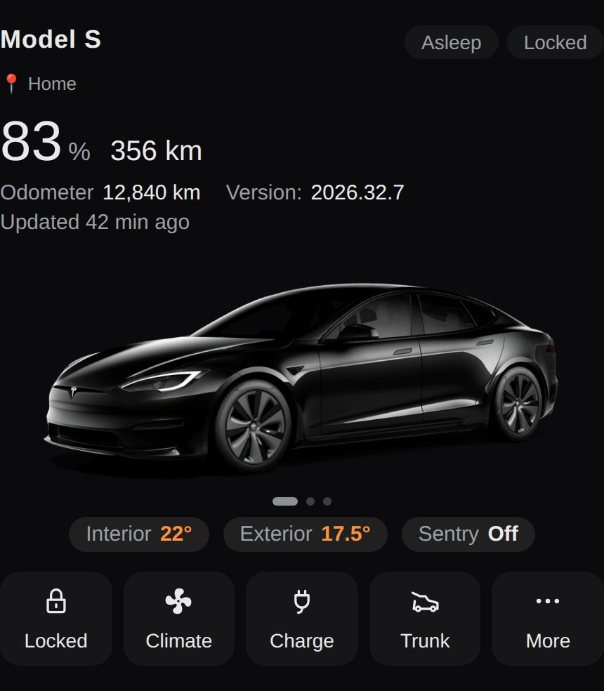 |
| Model Y 2020–2025 preset, Deep Blue Metallic | Model S 2021+ preset, Solid Black |
| 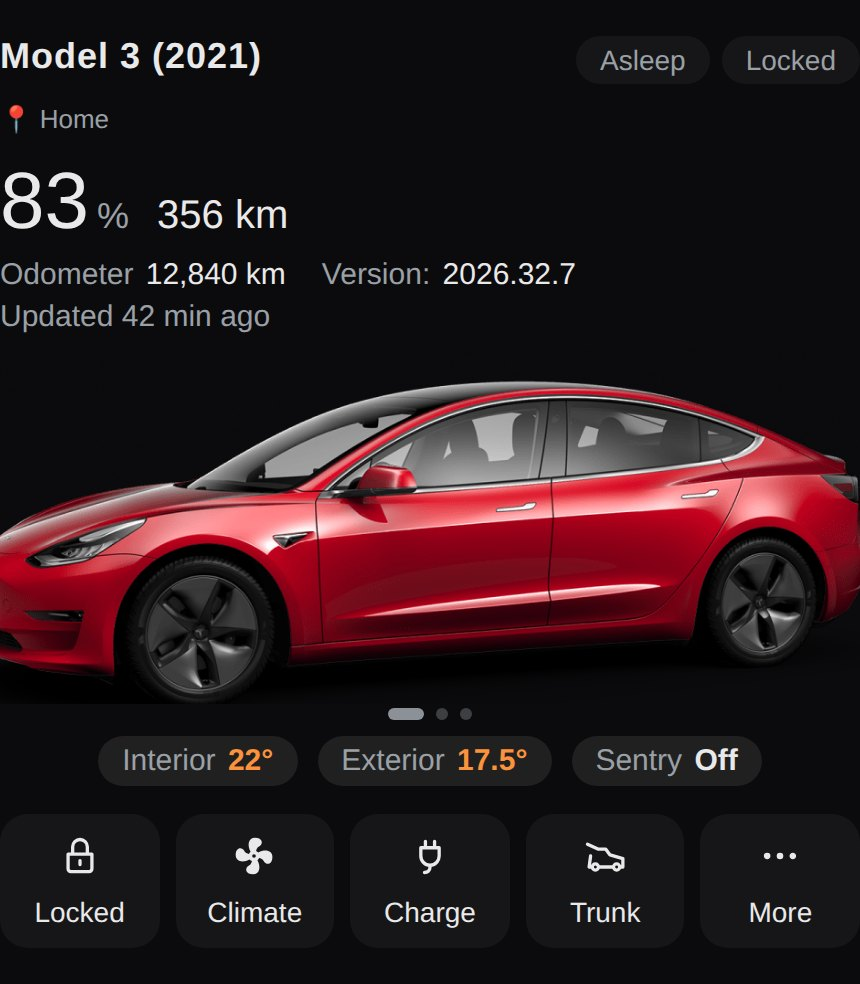 | 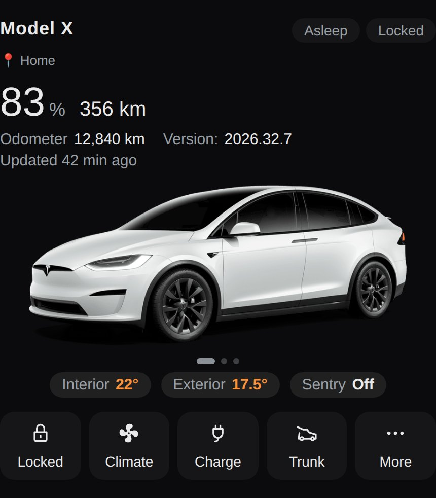 |
| Model 3 2017–2024 preset, Red Multi-Coat | Model X 2021+ preset, Pearl White |
| 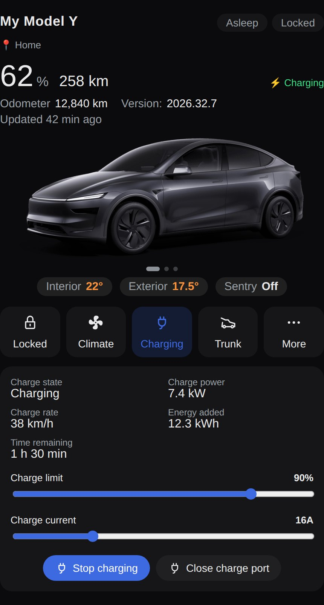 | 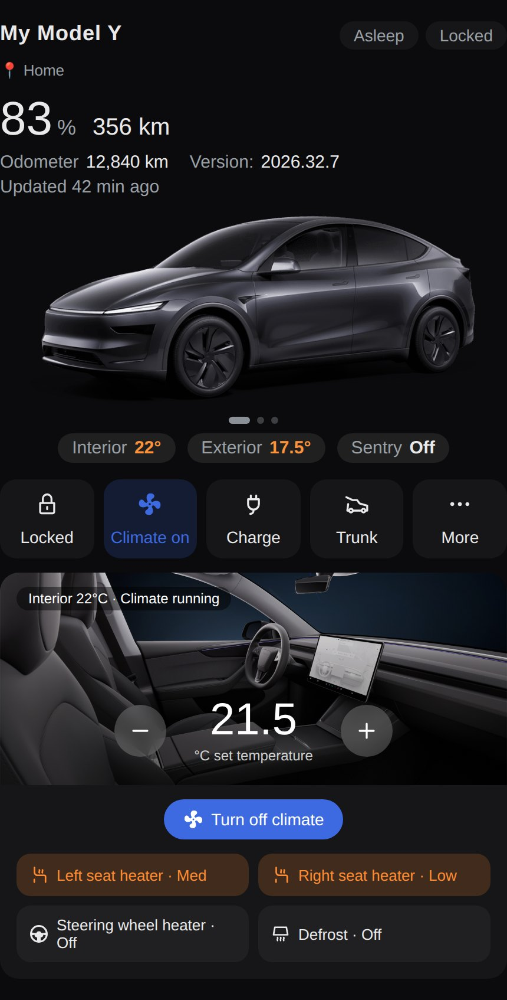 |
| Charge panel: charge state, power, rate, energy added, time remaining, limit & current sliders | Climate panel over the official interior render: target temperature, seat and steering-wheel heaters |
| 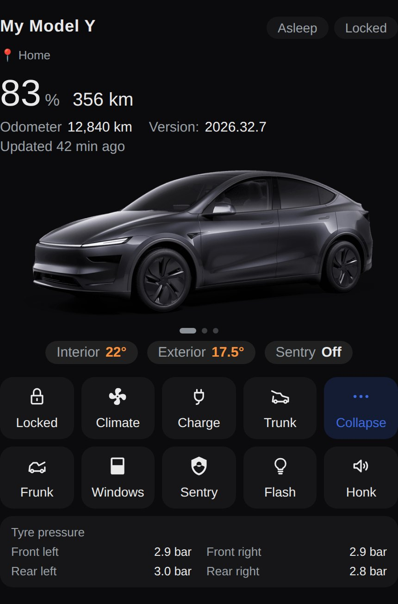 | 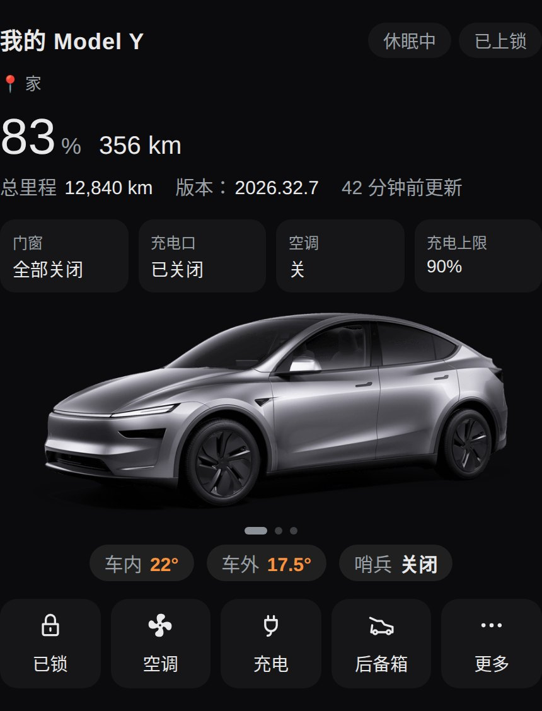 |
| More panel: quick actions and the tyre-pressure grid | Chinese UI with the opt-in status row (`show_status: true`) |
| 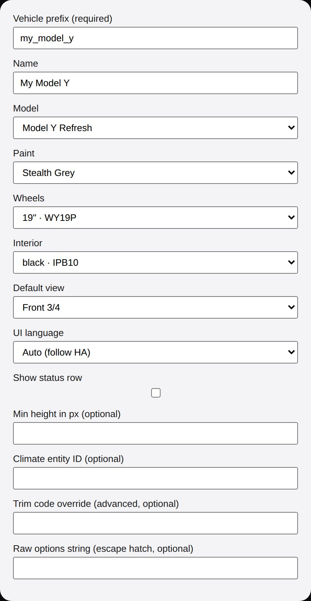 |  |
| Visual editor: model-linked dropdowns for paint / wheels / interior — no YAML required |  |

## Requirements

- Home Assistant with a Tesla integration that follows the **Tesla Fleet** or **Teslemetry** entity naming style (the official Tesla Fleet integration works out of the box).
- Internet access to `static-assets.tesla.com` on the device displaying the dashboard (for the car images).

## Installation

### Via HACS (custom repository)

1. In Home Assistant, open **HACS → ⋮ (top right) → Custom repositories**.
2. Add `https://github.com/AidaShika/hass-tesla-vehicle-card` with category **Dashboard** (Lovelace).
3. Find **Tesla Vehicle Card** in HACS and download it.
4. Reload your browser / fully restart the companion app.

### Manual

1. Get `tesla-vehicle-card.js` from this repository — open the file in the repo and download the raw file, or extract it from the source archive (zip / tar.gz) on the [releases page](https://github.com/AidaShika/hass-tesla-vehicle-card/releases).
2. Copy it to `/config/www/tesla-vehicle-card.js` on your Home Assistant instance.
3. Go to **Settings → Dashboards → ⋮ → Resources → Add resource**:
   - URL: `/local/tesla-vehicle-card.js`
   - Resource type: **JavaScript module**
4. Reload your browser.

> Coming from the private 1.x builds (`custom:model-y-card`)? That element name stays registered as a legacy alias — existing dashboards keep working unchanged. New configs should use `custom:tesla-vehicle-card`.

## Configuration

Add the card to a dashboard — either with the visual editor, or in YAML (see [examples/dashboard.yaml](examples/dashboard.yaml)):

```yaml
type: custom:tesla-vehicle-card
vehicle: my_model_y
name: My Model Y
```

| Option | Required | Default | Description |
| --- | --- | --- | --- |
| `vehicle` | **Yes** | — | Vehicle prefix used in entity IDs (e.g. `my_model_y` for `sensor.my_model_y_battery_level`). |
| `name` | No | `Model Y` | Display name shown at the top of the card. |
| `model` | No | `modely_juniper` | Model preset: `modely_juniper` \| `modely_legacy` \| `model3_legacy` \| `models_refresh` \| `modelx_refresh`. Existing configs without `model` are treated as `modely_juniper`, unchanged. |
| `paint` | No | per model | Paint key — the available paints depend on `model`, see the table below. |
| `wheels` | No | per model | Wheel size — the available wheels depend on `model`, see the table below. |
| `interior` | No | per model | Interior key — the available interiors depend on `model`, see the table below. |
| `view` | No | `3qtr` | Default image view: `3qtr` \| `side` \| `rear`. Swipe or tap the car to switch. |
| `climate` | No | `climate.{vehicle}_climate` | Climate entity ID, if yours differs from the derived one. |
| `entities` | No | — | Map of per-entity overrides, keyed by the card's internal entity keys (see below). |
| `language` | No | `auto` | UI language: `zh` \| `en` \| `ja` \| `auto` (follow Home Assistant's language). |
| `show_status` | No | `false` | Show the status row (doors & windows / charge port / climate / charge limit). Hidden by default; set to `true` to show it. Independent of `min_height`. |
| `min_height` | No | — | Stretch the card to a fixed minimum height in px (e.g. `876` for a full-screen phone dashboard). |
| `trim` | No | per model | Advanced: override the model's compositor trim code (e.g. `MT317` on a legacy Model 3 to get the 2021+ black-trim styling and its Performance wheels). |
| `image_options` | No | — | Escape hatch: a full compositor options string (see below). When set, `paint` / `wheels` / `interior` / `trim` are ignored. |

### Models and verified options

Option codes verified against Tesla's live configurator on **2026-10-24**. Only verified options are offered — the configurator rejects the entire request when any single code is invalid, and it silently returns a shadow-only image when no trim code is present, so presets never guess.

| Model (`model:`) | Paints | Wheels | Interiors |
| --- | --- | --- | --- |
| `modely_juniper` — Model Y 2025+ refresh | `stealth_grey` (PN01), `quicksilver` (PN00), `pearl_white` (PPSW), `solid_black` (PBSB), `ultra_red` (PR01), `deep_blue` (PPSB) | `19` Crossflow (WY19P), `20` Helix 2.0 (WY20A) | `black` (IPB10), `white` (IPW10) |
| `modely_legacy` — Model Y 2020–2025 | `pearl_white` (PPSW), `midnight_silver` (PMNG), `deep_blue` (PPSB), `red_multicoat` (PPMR), `solid_black` (PBSB), `quicksilver` (PN00), `ultra_red` (PR01) | `19` Gemini (WY19B), `20` Induction (WY20P) | `black` (INPB0), `white` (INPW0) |
| `model3_legacy` — Model 3 2017–2024 | `midnight_silver` (PMNG), `pearl_white` (PPSW), `deep_blue` (PPSB), `solid_black` (PBSB), `red_multicoat` (PPMR) | `18` Aero (W38B), `19` Sport (W39B), `20` Performance (W33D, needs a Performance `trim` such as `MT317`) | `black` (IN3PB), `white` (IN3PW) |
| `models_refresh` — Model S 2021+ | `solid_black` (PBSB), `ultra_red` (PR01), `pearl_white` (PPSW) | `19` Tempest (WS90), `21` Arachnid (WS12) | `black` (IBE00), `cream` (IBC00) |
| `modelx_refresh` — Model X 2021+ | `pearl_white` (PPSW) | `22` Turbine (WX00) | `black` (IBE00) |

Notes:

- Legacy Model Y interiors `black_dark_headliner` / `white_dark_headliner` from earlier private builds still work on `modely_juniper` (codes IPB11 / IPW11, not re-verified in the 2026-10-24 matrix, so they are not offered in the editor).
- Model S / X have no interior (seat) view in the configurator, so the climate panel uses the exterior render as its background there.
- The compositor sometimes returns HTTP 200 with a shadow-only image when parameters are inconsistent; the card samples loaded images and falls back to the "image failed" message in that case.

### The `image_options` escape hatch

For any model without a preset — Model 3 "Highland", pre-refresh Model S, unusual years/trims — paste the full options string used by your own car's image:

1. Open your Tesla account (or a site like tesla-info) and find your vehicle's image URL; it contains an `options=` parameter such as `$MDLY,$MTY09,$PPSW,$WY19B,$INPW0`.
2. Copy that whole parameter value into `image_options`:

```yaml
type: custom:tesla-vehicle-card
vehicle: my_model_3
name: My Model 3
model: model3_legacy   # sets the compositor model= parameter (m3); use any preset with the right car family
image_options: "$MTxxx,$PPSW,$Wxxxx,$IPxxx"   # placeholder shape — paste YOUR car's real string
```

When `image_options` is set, `paint` / `wheels` / `interior` / `trim` are ignored; the `model` preset still provides the compositor `model=` parameter (defaults to `my` when no `model` is given).

## Entities

All entity IDs are derived from the `vehicle` prefix, following Tesla Fleet / Teslemetry naming. For example with `vehicle: my_model_y`:

| Purpose | Entity |
| --- | --- |
| Online / asleep | `binary_sensor.my_model_y_status` |
| Lock | `lock.my_model_y_lock` |
| Battery level / range | `sensor.my_model_y_battery_level` / `sensor.my_model_y_battery_range` |
| Odometer | `sensor.my_model_y_odometer` |
| Software update | `update.my_model_y_update` |
| Charging state / power / rate / energy added / time to full | `sensor.my_model_y_charging`, `_charger_power`, `_charge_rate`, `_charge_energy_added`, `_time_to_full_charge` |
| Charge cable / start-stop / limit / current / port door | `binary_sensor.my_model_y_charge_cable`, `switch.my_model_y_charge`, `number.my_model_y_charge_limit`, `number.my_model_y_charge_current`, `cover.my_model_y_charge_port_door` |
| Temperatures (in / out) | `sensor.my_model_y_inside_temperature` / `sensor.my_model_y_outside_temperature` |
| Frunk / trunk / windows | `cover.my_model_y_frunk` / `cover.my_model_y_trunk` / `cover.my_model_y_windows` |
| Sentry / defrost | `switch.my_model_y_sentry_mode` / `switch.my_model_y_defrost` |
| Seat & wheel heaters | `select.my_model_y_seat_heater_front_left`, `_front_right`, `select.my_model_y_steering_wheel_heater` |
| Honk / flash / wake buttons | `button.my_model_y_honk_horn` / `button.my_model_y_flash_lights` / `button.my_model_y_wake` |
| Door & window sensors | `binary_sensor.my_model_y_{front,rear}_{driver,passenger}_{door,window}` |
| Climate | `climate.my_model_y_climate` (overridable via `climate:`) |
| Tyre pressures | `sensor.my_model_y_tire_pressure_front_left` / `_front_right` / `_rear_left` / `_rear_right` (Fleet), or `sensor.my_model_y_tpms_pressure_fl` / `_fr` / `_rl` / `_rr` (Teslemetry) — the first candidate that exists is used |
| Location | `device_tracker.my_model_y` (or `device_tracker.my_model_y_location`) |
| Navigation | `sensor.my_model_y_active_route_destination`, `sensor.my_model_y_active_route_distance_to_arrival`, `sensor.my_model_y_active_route_time_to_arrival` (or the bare names `sensor.my_model_y_destination`, `_distance_to_arrival`, `_time_to_arrival`) |

Any derived entity can be replaced individually through the `entities:` map, using the card's internal keys (`battery`, `lock`, `frunk`, `sentry`, `seat_left`, `tpms_fl`, `tracker`, `destination`, …), e.g.:

```yaml
entities:
  battery: sensor.my_custom_battery_level
  tpms_fl: sensor.my_custom_tpms_front_left
```

Entities that don't exist in your setup are skipped where possible: action buttons for missing entities are not rendered, the tyre-pressure block hides itself when no sensor exists, and panels degrade gracefully.

## Disclaimer

- **Vehicle images are served live by Tesla's official CDN** (`static-assets.tesla.com`). All vehicle artwork is **© Tesla, Inc.**; this project only assembles configurator option parameters (paint / wheel / interior codes) into an image URL. It does not redistribute Tesla's images.
- Most icons are original line drawings created for this project in the visual style of the Tesla app; they are **not Tesla's official icon assets**. Four icons (fan, sentry shield, window, steering wheel) use the original Material Design Icons glyphs — the same set Home Assistant ships (Apache License 2.0).
- This is an unofficial community project and is **not affiliated with, endorsed by, or sponsored by Tesla, Inc.**
- Because the images depend on Tesla's configurator service, **changes to Tesla's website or API may break image rendering at any time**.
- Controlling a real vehicle from a dashboard is inherently sensitive — destructive actions in this card ask for confirmation (two-tap), but use it at your own risk.

## Roadmap

- Model 3 "Highland" preset — waiting for a verified trim code; until then use `image_options` with your own car's string
- Cybertruck — the configurator compositor does not support it (verified 2026-10-24); revisit if that changes
- P2: rear seat heaters, partial (non-full) re-rendering
- More polished English copy and additional languages

## Development

No build step — edit `tesla-vehicle-card.js` directly. Smoke tests (plain Node, stubbed DOM):

```bash
node --check tesla-vehicle-card.js
node tests/smoke.mjs
```

## License

[MIT](LICENSE) © 2026 AidaShika
